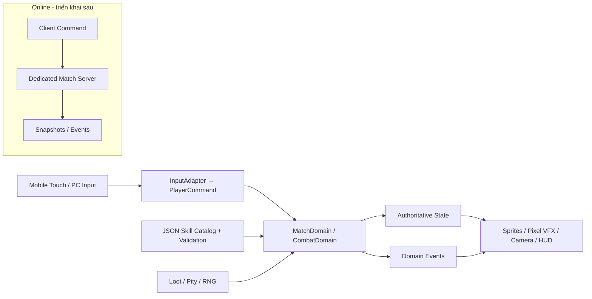

# ARCHITECTURE.md — Kiến trúc Godot cho Shinobi Evolution

**Trạng thái:** `OFFICIAL_DESIGN_BASELINE / NOT YET IMPLEMENTED` • **Phiên bản:** 2.1 • **Ngày:** 2026-10-16.

> Kiến trúc đích cho baseline solo hai người, Uchiha/Hỏa. Module bên dưới là specification để triển khai theo task và review; trạng thái ADR phân biệt lựa chọn đã chốt với phương án còn cần thử. Tài liệu không phải bằng chứng module đã chạy.

**Phạm vi chính:** solo sinh tồn **hai người/trận**, mỗi người một phe, thời lượng mục tiêu 20–25 phút; chọn vùng xuất phát rồi spawn ngẫu nhiên có khoảng cách an toàn. Loot/farm, build, vòng bo và Thế thân bị động là các luồng cần kiểm chứng; không có hồi sinh hoặc cứ điểm buff trong solo. Luật đội được lưu tham chiếu trong `GAME_DESIGN.md` §3.5, không tự triển khai vào mode chính. Tăng số người là mở rộng để sau.

**Quyền triển khai hiện hành:** theo [ANTIGRAVITY_AUTOPILOT](ANTIGRAVITY_AUTOPILOT.md), Antigravity tự làm/test/sửa liên tục đến M8; chi tiết OPEN được đặc tả trong quyền đã giao, không dừng xin duyệt từng task. Giá trị khởi đầu ở [profile](../data/prototypes/solo_first_playable.json), art qua [generate_image guide](ART_GENERATION_GUIDE.md). Những module dưới đây vẫn là đích phải triển khai, không phải tính năng đã chạy.

## 1. Công nghệ đã chọn và những thứ để sau

| Lớp | Quyết định | Ghi chú |
|---|---|---|
| Editor quản lý dự án | VS Code | Explorer/Git/diff, Antigravity code, Codex review |
| Engine | Godot 4 **Standard/GDScript**, xác nhận binary/build ở M0-01 | `config/features` trong project không thay cho bằng chứng executable; chỉ pin cấu hình sau audit |
| Programming | GDScript | script có typed signatures; signals cho event UI |
| Render | Compatibility cho prototype theo A-007 | Được đổi cấu hình debug sau audit/ghi diff theo AUTOPILOT; ghi thực tế trước/sau, kiểm rendered |
| Game view | 2D top-down 3/4 camera MOBA | `Camera2D`, `CharacterBody2D`, `TileMapLayer` tùy phiên bản 4.x |
| Graphics | 2D HD Pixel Art, sprite sheet + light pixel VFX | 32×32 tiles, 48×64/64×64 character candidate, nearest-neighbor world |
| Mobile | Android landscape, touch+safe area | PC keyboard/mouse chỉ để debug |
| Network | Offline trước, spike/server authoritative ENet local/LAN sau M3 | M7 tích hợp hai client; không tự thêm Nakama/tài khoản/backend ngoài |
| Versioning | Git diff + local checkpoint | Không tự commit/push/merge; VERIFIED cho phép tiếp tục task |
| Data | JSON graph + typed domain models | Catalog thiết kế 162 node; bản đầu bật allowlist Uchiha/Hỏa được đặc tả riêng, validator bắt buộc |
| Backend | Godot match server riêng trong baseline; dịch vụ ngoài để sau | Server headless + hai client, không lấy host player làm nguồn tin cậy |

**Tài liệu chính thức khi cần kiểm API:** https://docs.godotengine.org/en/stable/ ; check theo **phiên bản thực tế đã pin** vì API có thể đổi giữa Godot 4.x.

## 2. Sơ đồ hệ thống



**Nguyên tắc:** Hành vi game đi từ lệnh đầu vào → mô hình trận → kết quả → presentation. Sprite hoặc button **không tự cấp Ryō, XP, loot, skill**. Khi prototype offline, `LocalMatchAuthority` thực thi API giống authority tương lai để giảm chi phí chuyển online; **không** cố viết full networking ngay.

## 3. Cấu trúc folder trong project

```text
shinobi-evolution/
  AGENTS.md
  project.godot                       # được Godot tạo, không tạo giả
  docs/
    GAME_DESIGN.md
    ARCHITECTURE.md
    SKILL_SYSTEM.md
    DEVELOPMENT_ROADMAP.md
  data/
    skills/skills.json                # catalog design-time (162 nodes)
    clans/                            # chỉ tạo khi có schema và task
    items/
  scenes/
    main/main.tscn
    actors/player/player.tscn
    actors/enemy/basic_enemy.tscn
    maps/test_arena.tscn
    maps/tilesets/
    ui/hud.tscn
    ui/virtual_joystick.tscn
    ui/skill_graph.tscn
    combat/projectiles/
    combat/vfx/
  scripts/
    app/
    input/
    domain/
      actors/
      combat/
      skill_graph/
      economy/
      loot/
      match/
    infrastructure/
      data/
      persistence/
      network/                       # chưa dùng trong prototype
    presentation/
      actors/
      hud/
      vfx/
  assets/
    sprites/characters/
    sprites/enemies/
    tilesets/
    vfx/
    ui/
    audio/
  tests/
    unit/
    integration/
    fixtures/
  builds/                             # ignored bởi git
```

**Nguyên tắc đặt tên:** `snake_case` file và script; `PascalCase` lớp `class_name` khi thật sự cần chia sẻ; skill/item/clan ID dạng `UPPER_SNAKE_CASE` ổn định.

**Không tạo tất cả thư mục trống trong task 1.** Scene/script tạo theo yêu cầu; mỗi thư mục phải gắn với module thực tế.

## 4. Hợp đồng scene và ownership

### 4.1 Main + Map (proposal)

```text
Main (Node2D)
  MatchRoot (Node2D)
    World (Node2D)
      Ground (TileMapLayer)
      Obstacles (TileMapLayer)
      Entities (Node2D, y_sort_enabled=true)
      GroundTelegraphs (Node2D)
      GameplayVolumes (Node2D)
    LocalPlayer (instance player.tscn)
  WorldCamera (Camera2D)
  UI (CanvasLayer)
    HUD (Control)
    Controls (Control)
    Toasts (Control)
```

Nếu dùng `YSort` dưới actor/props, `z_index` và sorting origin đặt ở chân sprite, không dựa vào phần đầu/tóc. Các `TileMapLayer` ở Godot 4.x cần xác nhận trong version pinned trước khi code; không tạo scene với node không có trong engine đang dùng.

### 4.2 Player (proposal)

```text
Player (CharacterBody2D)
  CollisionShape2D
  VisualPivot (Node2D)
    AnimatedSprite2D
    CastAnchor (Marker2D)
    StatusMarkers (Node2D)
  HitReceiver (Area2D)        # nhận hit logic; tách body collision
  AnimationPlayer
  Components (Node)
    ActorStats
    SkillLoadout
    StatusContainer
```

`PlayerController` nhận `PlayerCommand`, điều khiển actor domain; `PlayerView` chỉ play animation/chạy VFX. HP và mana/chakra thuộc domain/state, không lưu độc quyền trong HUD.

### 4.3 Camera và Mobile HUD

- `Camera2D`: theo local actor; zoom chỉ thay đổi mức cần thiết, không cho camera cắt mất telegraph của kẻ địch mà vẫn gây hit. Có cấu hình giới hạn map và smooth follow.
- `CanvasLayer` UI anchor theo viewport thực, lấy safe-area nếu có; tách **world logical resolution** khỏi **screen UI readability**.
- Left virtual joystick: pointer/touch ID cố định khi giữ; deadzone, clamp radius, convert về vector normalized.
- Right buttons: basic attack, 4 skills, 1 ultimate, nhẫn cụ; hỗ trợ drag-to-aim, visual cool-down và trạng thái `out_of_chakra`. Thế thân bị động chỉ có indicator số cuộn/trạng thái, không phát cast command từ button.
- Input PC debug: WASD, chuột aim, hotkey 1–5/Space. **Không** làm gameplay phụ thuộc con trỏ chuột.

## 5. Chia module và API khuyến nghị

| Module | Trách nhiệm | Không được làm |
|---|---|---|
| `InputAdapter` | ánh xạ touch/keyboard → `PlayerCommand` | tự gây damage hoặc mua skill |
| `ActorMovement` | velocity, dash, collision, move restrictions | ghi trực tiếp UI |
| `ActorStats` | HP, chakra, levels, resistances, events | tự spawn loot |
| `CombatResolver` | target checks, hit/damage/heal/CC; kiểm Thế thân bị động trước chết, log combat | quyết định bằng frame animation/VFX |
| `SkillCatalog` | load/validate/lookup design catalog | cho phép mua node locked |
| `SkillUnlockService` | check level/SP/Ryō/AND/OR/gates/exclusions, quyền hệ thứ ba qua sự kiện | bỏ qua gate tiếng Việt; hoàn SP/quên node trong trận |
| `SkillLoadout` | equipped active/ultimate/passive/substitution; đổi ngoài giao tranh theo authority | trang bị node chưa có runtime implementation; reset cooldown khi đổi ô |
| `SkillExecutor` | gọi ability behavior đã đăng ký | giant switch 162 ID |
| `LootService` | drop table, pity, loot rights và seed | RNG client khi online |
| `EconomyService` | XP/Ryō/SP reward và spend atomic | âm tiền, double spend |
| `MatchStateMachine` | phase/vòng bo, loại người chơi và thắng solo sinh tồn | đọc FPS để suy luận state; tự thêm hồi sinh, quyền phong ấn hoặc cứ điểm buff vào solo |
| `WorldReactionService` | tags môi trường + tương tác có giới hạn | tạo tự động huyết kế |
| `VFXPresenter` | telegraph, particles, animation/audio | xác thực hit hoặc range |
| `DataValidator` | schema, references, graph DAG, gate readiness | âm thầm bỏ qua node lỗi |

**Thông điệp domain định dạng typed**, ví dụ:

```gdscript
# Khung API để triển khai sau, không phải file đã được tạo.
class_name PlayerCommand
extends RefCounted

var move_axis: Vector2 = Vector2.ZERO
var aim_axis: Vector2 = Vector2.ZERO
var cast_slot: int = -1  # -1 = không cast
var is_dashing: bool = false
```

Game prototype có thể dùng signals `hp_changed`, `skill_unlocked`, `currency_changed` cho UI; khi online, các event được phát từ trạng thái server xác nhận, không phải client tự thay data.

## 6. Runtime model các kỹ năng

**Hai lớp dữ liệu khác nhau:**

1. `data/skills/skills.json` là **catalog thiết kế và đồ thị**. Một node có thể là root/passive/tier gate; chưa bắt buộc có damage/cooldown.
2. `SkillRuntimeDefinition` là **hợp đồng combat hoạt động**, chỉ áp dụng cho ID có handler và kiểm thử thật. Khi code tạo `data/runtime/abilities.json` và `data/runtime/content_manifest.json`; mỗi entry trỏ ID catalog, chỉ cho tập đã giao.

Không giả định mọi node là chiêu cast. Catalog raw giữ design_only/approved_for_runtime=false; nghĩa là không được nạp nó trực tiếp thành bộ combat. Trạng thái runtime **hiệu lực** được hợp nhất từ catalog + manifest riêng, chỉ thành implemented khi ID thuộc allowlist, có runtime binding/handler đã kiểm, đúng slot và đủ resolver. Tồn tại entry JSON hoặc tên handler không đủ chứng minh triển khai. Ngoài tập đó vẫn khóa; UI/client không được tự override status. Graph/cost/gate gốc không bị manifest âm thầm thay.

### 6.1 Loader, schema và validation

Đọc `SKILL_SYSTEM.md` mục Schema để biết các field chi tiết. Quy trình load:

```text
Read JSON → check schema_version / metadata
  → validate node IDs unique, tier 0..5, rank, required types
  → validate prereq references and requires_any groups
  → detect cycles (topological sort)
  → validate synergy type and inputs (skill_id or element_token)
  → validate optional runtime bindings / entrypoints
  → merge per-ID runtime readiness + tested predicate registry, fail-closed otherwise
  → report errors (fail-fast in test/debug)
```

Catalog không được gọi "production ready" chỉ vì JSON parse được. Với `unlock_gate` dạng chuỗi còn lại, **gate trạng thái chưa cấu hình phải `LOCKED`**, UI hiện "Chưa hoàn tất điều kiện mở nhánh" kèm nhãn thiết kế khi ở debug; không tự cho qua.

### 6.2 Mô hình check unlock

```
can_unlock(actor, skill_id, match_state):
  require(skill_id exists && implementation approved for progression)
  require(actor.level >= tier.min_level)
  require(all prereqs in requires_all are learned)
  require(for each OR group in requires_any, at least one is learned)
  require(gate policy explicitly resolved and evaluates true)
  require(not blocked by exclusive group / clan / bloodline)
  require(actor.SP >= skill cost.SP && actor.Ryō >= cost.Ryō)
  require(if needed, server-auth inventory item/pact/quest flag)
  then atomic transaction: spend → learn → consume item → emit event
```

**Lưu ý:** node `T0` khởi đầu được cấp theo policy, không cần người chơi thao tác mua. Sự phát triển Hiden/huyết kế chỉ thông qua policy đã duyệt; `unlock_gate` hiện là chú thích **chưa chạy máy**.

**Quyết định đã chốt:** `BUILD-02` giữ learned state, không có lệnh hoàn điểm trong trận; `NATURE-01` cho hai hệ thông thường, hệ thứ ba cần quyền từ sự kiện hiếm cùng toàn bộ gate còn lại. Quyền có cuộn không tự thay quyền sự kiện.

**Equip tách khỏi unlock:** `LOADOUT-01` chỉ đổi kỹ năng đã sở hữu khi ngoài giao tranh, ở bất kỳ vị trí nào. Authority kiểm trạng thái giao tranh theo policy trong `SKILL_SYSTEM.md`; cooldown thuộc state kỹ năng của actor và không bị reset do thay slot. Đổi preset chỉ đổi kế hoạch UI, không ghi đè learned/currency/cooldown state. Định nghĩa cửa sổ combat và lifecycle buff/summon vẫn cần được chốt trước task loadout.

### 6.3 Hành vi kỹ năng mở rộng

Thay vì 162 class không chia sẻ logic, triển khai ability archetypes:

- `ProjectileAbility`: Hỏa Cầu, Thủy Đạn, Shuriken.
- `DashAbility`: áp sát/lướt/Thiên Điểu biến thể.
- `AreaAbility`: Hỏa Vực, Thổ Trận, sương, bẫy.
- `MeleeHitAbility`: Nhu Quyền, combo thể thuật.
- `BuffAbility`: Sharingan state, Bát Môn, chakra armour.
- `ControlAbility`: trói bóng, stun, câm kỹ năng, Genjutsu.
- `SummonAbility`: Ảnh Phân Thân, côn trùng, nhẫn khuyển, khôi lỗi.
- `BarrierAbility`: kết giới, tường đất, ma kính.

Các giá trị cụ thể do runtime def có schema/validator riêng, **không hardcode** theo tên Việt. `skill_id` để tra dữ liệu, `archetype` để gọi behavior, `tags` để tương tác.

### 6.4 Trạng thái và hiệu ứng kết hợp

Status tags đề xuất: `WET`, `BURNING`, `ELECTRIFIED`, `SHADOW_BOUND`, `CHAKRA_SEALED`, `STEALTH`, `MARKED`, `INVULNERABLE_WINDOW` (có TTL + stacking rule). Tags dùng trong va chạm, không phải phép tạo huyết kế.

Phản ứng nước + điện: area có `WET` → điện tương tác → lan theo danh sách target được xác nhận, giới hạn số chain và độ sâu, **server tính hit, client vẽ tia**. Hỏa + Phong: thay đổi bán kính/tốc độ vùng lửa **chỉ khi có rule**, không tự nhân damage không giới hạn.

## 7. Combat và phép tính authoritative

### 7.1 Pipeline đề xuất

```text
PlayerCommand: cast(slot, direction, optional target)
 → validate alive/not CC, loadout + cooldown + chakra
 → consume costs, start cast on authority
 → telegraph/cast event (camera không quyết định hit)
 → resolve range/collision/LOS/team filter
 → CombatResolver: mitigation, shield, damage, CC diminishing returns
 → apply state and emit result event
 → renderer animate result
```

Bảng giá trị damage thật chưa chốt. Ưu tiên **fixed-step** logic, state transitions rõ; không dùng `delta` phân tán theo FPS để đổi kết quả combat. `Area2D` hỗ trợ broad-phase nhưng không dùng signal client cục bộ làm bằng chứng authority cho kill.

### 7.2 Anti-CC chain

Diminishing returns theo nhóm effect và khoảng thời gian. Thế thân solo là bị động ở ngưỡng sát thương gây chết; khi kích hoạt xóa CC và toàn bộ hiệu ứng bất lợi đang có theo SOLO-SUB-08. Bị động không đi qua kiểm tra cast intent chủ động nên stun không tự chặn kích hoạt; nó vẫn kiểm số cuộn/cooldown. Không cấp miễn hiệu ứng mới. Quy tắc chống chain-lock cần test và cấu hình, không để target mất quyền thao tác > một ngưỡng không kiểm soát.

### 7.3 Hợp đồng match đã chốt về gameplay

- `IDENTITY-01` / `MODE-01`: sinh tồn solo là trọng tâm, mỗi người một phe, người sống sót cuối cùng thắng; farm quái phục vụ tiến trình XP.
- `OBJECTIVE-01`: bỏ cứ điểm/phong ấn chiếm giữ để nhận buff. Các luật SEAL-01/SEAL-02 đã bị thay thế.
- `SOLO-LIFE-01`: người chết bị loại, không hồi sinh; không có trụ hồi sinh/cứu đồng đội trong luồng solo.
- `ZONE-01` / `MATCH-04`: authority quản lý phase vùng an toàn và sát thương bên ngoài; 20–25 phút là mục tiêu thời lượng, không là timeout. `MATCH-02/03`: match hai người; authority xác nhận spawn ngẫu nhiên hợp lệ trong vùng đã chọn và khoảng cách an toàn, không tin tọa độ client tự gửi.
- `SOLO-SUB-01..07`: grant một cuộn, cap hai; bị động tự tiêu cuộn trước damage gây chết (kể cả vòng bo), hồi HP theo config, tàng hình và bắt đầu cooldown nội tại. Không có cast intent chủ động.
- Trong cooldown, lethal hit giết được dù còn cuộn; nhặt cuộn khác không reset timer. Tàng hình vẫn nhận damage; damage gây/nhận sau kích hoạt làm lộ thân, không xóa cooldown. Kiểm/replicate số cuộn, cooldown và trạng thái ẩn trên authority.
- Tại bước áp damage, authority commit cùng kết quả tiêu cuộn/HP/stealth/cooldown hoặc chết; không phát kill/reward/elimination rồi mới sửa bằng "hồi sinh". Đòn được chặn không được áp lại để phá ẩn. Một hit/event ID chỉ giải quyết một lần; hit hợp lệ khác cùng tick xét tiếp với HP mới và cooldown đã chạy, không có miễn damage ngầm.
- `SOLO-SUB-08`: cùng giao dịch kích hoạt phải xóa effect bất lợi cũ và hủy các tick DOT còn chờ của effect đã xóa. Debuff thuộc hit kích hoạt không được áp lại sau thanh tẩy; effect mới từ hit/nguồn khác vẫn áp được ngay. Danh mục effect phải phân loại rõ để không âm thầm miễn trừ một CC/reveal bất lợi; vòng bo tiếp tục là nguồn damage môi trường.
- `SOLO-SUB-09`: cấu hình thử 25% max HP sau kích hoạt, stealth tối đa 3s, cooldown 60s. Authority dùng thời gian mô phỏng, không lấy đồng hồ/cooldown client; lộ sớm không kết thúc cooldown.
- `MATCH-05`: gom/xác định các event damage hợp lệ của tick, giải quyết damage/Thế thân trước khi chốt kết quả. Không free actor/hủy hit đã hợp lệ của cùng tick chỉ do thứ tự vòng lặp làm actor kia bị loại trước. Sau batch mới cleanup, xét số người sống và phát một result: một người sống thì thắng, không ai sống thì hòa. Không tuyên bố thắng trong callback chết đầu tiên.
- `MATCH-06`: disconnect xóa input đang giữ, actor đứng yên nhưng simulation vẫn chạy, có thể bị CC/damage/bo và tự xét Thế thân. Không có timer tự loại vì disconnect. Reconnect ràng cùng player/match/actor, không tạo bản sao, reset state hoặc cấp lại cuộn; actor đã bị loại không trở lại chơi.
- `ZONE-02`: bo cuối hết vùng an toàn, damage tăng theo config đủ buộc kết thúc; không vô hiệu Thế thân hoặc dùng mốc 25 phút làm auto-win. Luật đội WIN-01/REVIVE-01/ELIM-01 chỉ lưu cho tương lai.

## 8. PvE / loot / economy transactions

- NPC spawn manager theo zone có giới hạn entity, không spawn hàng trăm AI ngoài màn hình.
- `ECON-02` / `REWARD-02`: giữ XP/SP/Ryō và chi phí SP/Ryō khi học node. Quỹ XP/Ryō theo bên kết liễu; ở solo recipient là người kết liễu. Chia đều cho đồng đội là policy để sau nếu mở mode đội.
- `LOOT-02`: cuộn/mảnh hiếm elite/boss là vật phẩm world công khai, mọi người chơi được tranh nhặt; authority xác nhận pickup atomic, không cấp private entitlement mặc định theo người hạ boss.
- `LOOT-04`: actor bị loại chuyển toàn bộ item inventory, gồm cuộn Thế thân còn lại, thành loot công khai một lần. Remove inventory và create loot chung giao dịch; retry death không tạo bản sao. Không spawn XP/SP/Ryō hoặc learned node thành vật phẩm; Thế thân thành công không phát death/drop.
- `BUILD-03` / `LOADOUT-01`: `learn` và `equip` đều yêu cầu alive/ngoài combat, kiểm trên authority lúc commit. Xem graph trong combat không cấp quyền mua và không pause simulation; request bị từ chối không mất tài nguyên hoặc tự xếp hàng mua lại.
- `COMBAT-02`: sau đủ 5s không gây/nhận damage hoặc dùng đòn/skill tấn công mới ngoài combat, cả PvE/PvP. Cập nhật combat timer theo event authority của tick trước commit learn/equip; không dùng state cũ khi UI mở.
- Loot table được version hóa, seed log trong dev. Pity state theo `(match_id, player_id, loot_group_id)`, không trộn counters giữa các nhóm.
- `PITY-02/03`: tham gia hợp lệ nhưng không nhận mảnh mục tiêu, kể cả bị người khác nhặt mất, là một lượt trượt cá nhân; miss thứ tư tạo quyền chọn trong reward đó. Xét pity độc lập với người nhận quỹ XP/Ryō.
- `PITY-04/05`: chụp eligibility khi mục tiêu chết theo ngưỡng thử 5% max HP/30s cuối và alive/in-area. Settle sau khi toàn bộ rare fragment của reward đã pickup/expired, không coi spawn là đã nhận. Event cùng nhóm áp theo thứ tự authority; world loot cần TTL hữu hạn.
- `PITY-06`: nhận mảnh mục tiêu/bảo hiểm hoặc đổi target cùng nhóm thì reset; lưu target revision của mỗi reward để không chuyển miss cũ sang mục tiêu mới. Filter/preset không tự reset hoặc sinh quyền.
- `LOOT-03/05`: tư liệu dùng chung inventory giới hạn ô; pity chuyển thẳng vào túi nếu đủ chỗ, đầy thì lưu private pending claim, không spawn ra đất. Claim kiểm alive/capacity và giao một lần, không tạo lại cùng chuỗi khi chờ/reconnect. Item đã giao vẫn rơi khi chết; claim chưa giao không biến thành item rơi hoặc tài nguyên trận sau.
- Mỗi phần thưởng có unique event/reward id và `consumed` flag hoặc idempotent transaction để chống nhận trùng khi reconnect.
- Mỗi thao tác mua node hoặc tiêu cuộn là một transaction logic riêng: cập nhật đủ mọi thành phần liên quan một lần, lỗi thì rollback trạng thái hợp lệ.
- Server quyết định drop, loot ownership, pickup range, cooldown pickup, vàng thu nhập và điều kiện mở nhánh.
- **Solo offline** `LocalMatchAuthority` đảm nhiệm cùng logic; không để client trực tiếp sửa via HUD.

## 9. Multiplayer — triển khai theo cổng kiểm chứng

Luồng nội dung đầu tiên là offline; M3-NET-01 là đề xuất spike riêng để kiểm rủi ro sớm, M7 tích hợp mạng cho hai người từ slice M6A. Backend/transport cần quyết định theo TECH-01; không tự kết nối dịch vụ. Mục tiêu online server authoritative, dùng cùng domain rules với offline.

### 9.1 Kiến trúc dài hạn

```text
Android Client (Godot)
  input prediction + VFX + UI
        |
      commands
        v
Match Server (dedicated/headless Godot hoặc authoritative service)
  validates input / state / damage / loot / unlocking / win
        |
      snapshots + events
        v
Android Client (reconciliation/interpolation)

Matchmaking / account / lobby (Nakama hoặc tương đương, quyết định sau spike)
```

**Phân công:** backend matchmaking có thể cấp phòng/đăng nhập, nhưng **không đương nhiên** là nơi tính hit. Trước khi triển khai, thực hiện spike đo độ trễ và kiến trúc giữa Godot server và Nakama. Không lập toàn bộ stack ngay bây giờ.

### 9.2 Hợp đồng tối thiểu

- Input command có `player_id` do session gán, sequence, timestamp kiểm tra giới hạn; dùng stream không tin client.
- Server chạy tick đều (mốc thử nghiệm 20–30Hz, chọn sau profiling) và gửi snapshot/interpolation; projectile hit được server xác nhận.
- Client có dự đoán chuyển động bản thân **nếu cần** nhưng không tự công nhận kill/loot/skill.
- Chống spam RPC, speedhack, teleport, spam cast, client time manipulation và payload `skill_id` lạ.
- Tái kết nối: session, snapshot, xử lý vật phẩm còn/đã consume, Grace period và trạng thái AFK.
- Data event theo match id + version/schema; không tiết lộ seed RNG thật nếu còn ảnh hưởng drop.

### 9.3 Bài test phản gian lận mẫu

1. Client gọi unlock T5 ở level 1 → server từ chối.
2. Client tự sửa HP=99999 → snapshot authoritative ghi đè.
3. Client báo trúng mục tiêu cách xa range → từ chối.
4. Client gửi cùng loot claim 2 lần → chỉ 1 transaction.
5. Client chưa có huyết kế mà gửi `YUKI_ICE` → từ chối.
6. Disconnect ngay lúc giết boss/claim loot → không được thưởng trùng.

## 10. Android + Pixel performance budgets

**Benchmark phải đo, không tuyên bố đạt sẵn.** Tùy thiết bị; ban đầu đặt mục tiêu 30 FPS ổn định ở cấu hình thử thấp và 60 FPS ở cấu hình khuyến nghị, rồi chỉnh sau khảo sát thiết bị.

- Map chunk/cell được load/AI simulate theo khoảng cách và mức ảnh hưởng trận, nhưng mục tiêu tranh chấp do authority vẫn cập nhật đúng.
- Sprite atlas, hạn chế material switch/texture fragmentation và overdraw; dùng `MultiMeshInstance2D`/particles phù hợp **chỉ khi profiling cho thấy cần**.
- VFX quality 3 cấp, giới hạn số emitter đang hoạt động, pooled projectile/impact decals; không spawn hàng nghìn côn trùng actor.
- Clone/summon tối đa theo kit; `entity_budget` toàn vùng và per-player cấu hình được. AI đơn giản tick thấp hơn camera nếu đủ xa; combat authority không bỏ tính toán cần thiết.
- Mob AI/đạn/vùng hiệu ứng không cập nhật bằng hàng trăm `_process()` thừa nếu có thể dùng manager/batching.
- Texture nearest-neighbor cho sprite; HUD font & touch icons có kích thước thực dễ đọc trên màn hình nhỏ. Viewport world thử `640×360`, scale test 16:9–20:9; kiểm safe area notch.
- Điện thoại nóng, RAM và battery drain là tiêu chí chất lượng; đo frame-time p95, draw calls, memory peak, network bytes/s; log theo thiết bị.

### 10.1 Chất lượng VFX khi teamfight

- Priorities: **enemy telegraph nguy hiểm > hit confirmation > self skill > ally cosmetic effect**.
- Có tùy chọn giảm flash/camera shake. Viền telegraph rõ trên nền rừng và mặt nước, không truyền thông tin chỉ bằng màu (thêm shape/icon/pattern).
- Animation cast có anticipation đủ để nhận biết; damage zone không bị thay bởi particle ngẫu nhiên.

## 11. Save / Settings / Content version

- Ngoài trận lưu: settings, preset build, keybindings/mobile layout, cosmetic, tutorial progress. Không lưu permanent combat stats mang vào ranked.
- Trong trận (online) lưu state trên authority: XP, currency, SP, learned node IDs, equipped IDs, items, pity, objective events. Client cache chỉ để hiển thị.
- Save/content data có `schema_version`, checksum hoặc build hash. Khi JSON thay đổi, chạy migration có kiểm tra; ID node không đổi nếu đã được save dùng.
- Release build không có debug unlock command hoặc developer cheat UI.
- Secrets/signing keystore không commit vào Git.

## 12. Kiểm thử và CI đề xuất

| Loại kiểm thử | Khi chạy | Tiêu chí |
|---|---|---|
| Data validator | mọi sửa `skills.json` | JSON parse, 162 IDs nếu chưa đổi, no dangling ref, no cycle, enums hợp lệ |
| Unit tests | khi thêm domain service | unlock AND/OR, đủ/thiếu Ryō, Pity, DR CC, HP không âm |
| Integration smoke | mỗi scene/feature | Godot import và chạy được main scene |
| Input touch QA | thêm HUD/mobile | không mất pointer ID khi 2 ngón, joystick reset khi nhấc tay |
| Perf stress | sau combat waves | quái + particle + skill bùng nổ vẫn đạt target đo được |
| Online authority tests | trước alpha PvP | client giả mạo hit/loot/unlock bị từ chối |
| Self-review / independent review nếu sẵn có | mỗi task | findings có bằng chứng; ghi NOT_RUN nếu chưa có reviewer độc lập, không chặn task VERIFIED |

**Ví dụ CLI khi đã có Godot executable:** `godot --headless --path . --editor --quit` để import/parse; `godot --headless --path . --quit-after 60` để smoke main (sau khi project có main scene). Chạy theo binary/version thực tế; không để AI tự báo PASS khi chưa mở project.

## 13. ADR — quyết định kiến trúc

| ADR | Trạng thái | Quyết định / lý do |
|---|---|---|
| A-001 | CHỐT | Godot 4 Standard + GDScript; dễ vibe code và tự chủ 2D |
| A-002 | CHỐT | VS Code làm trung tâm; Antigravity dev, Codex review |
| A-003 | CHỐT | Top-down 3/4 HD Pixel Art, mobile-first |
| A-004 | CHỐT | Data-driven skill graph, typed runtime behaviors, node ID không đổi |
| A-005 | CHỐT | Offline-first vertical slice; phải tách domain/input/presentation |
| A-006 | IMPLEMENTATION_DEFAULT | Server Godot riêng + ENet local/LAN cho hai client, tự kiểm spike theo AUTOPILOT; backend ngoài DEFERRED |
| A-007 | PROTOTYPE_DEFAULT | Compatibility, 640×360 world view đồng nhất giữa aspect ratio; được cấu hình debug/đo, chưa là benchmark Android |
| A-008 | PROTOTYPE_DEFAULT | Simulation 30Hz/snapshot 15Hz khởi đầu theo profile; chỉnh bằng số đo, chưa benchmark |
| A-009 | IMPLEMENTATION_DEFAULT | Catalog graph + manifest readiness/binding theo ID, tested resolver registry, ngoài allowlist fail-closed |

## 14. Điều kiện trước khi bắt đầu task đầu tiên

- Kiểm project/Git đang có bằng Godot; không tạo lại hoặc ghi đè project để bắt đầu checklist. M0-01 trong `TASK_BACKLOG.md` là điểm bắt đầu xác nhận môi trường.
- Antigravity kiểm **binary Godot phiên bản cụ thể** và setup local.
- M1 là task nhỏ di chuyển/camera/collision; khi VERIFIED phải tiếp tục M2..M8, không kết thúc toàn giao việc ở placeholder. Không thêm Nakama/database/162 handler.
- Review Codex phải tách lỗi thực tế và ý kiến kiến trúc để người mới không bị refactor vô hạn.

### Change Log

| Ngày | Phiên bản | Thay đổi |
|---|---|---|
| 2026-10-16 | 1.0 | Kiến trúc mobile Pixel Art, graph data-driven, workflow Antigravity/Codex và server-authority future plan |
| 2026-10-16 | 1.1 | Đồng bộ hợp đồng match với WIN-01, SEAL-01 và REVIVE-01 do Product Owner chọn; không thay module/protocol/storage hoặc cấu hình project |
| 2026-10-16 | 1.2 | Đồng bộ ZONE-01/SEAL-02/ELIM-01: vòng bo authority, hồi sinh tách phong ấn, loại đội ngay khi cả ba chết hẳn |
| 2026-10-16 | 1.3 | Đồng bộ BUILD-02/NATURE-01/LOADOUT-01: learned state không hoàn điểm, kiểm quyền hệ ba và equip ngoài combat không reset cooldown |
| 2026-10-16 | 1.4 | Đồng bộ REWARD-01/LOOT-02/PITY-02: chia thưởng XP/Ryō theo đội đủ điều kiện, pickup công khai atomic và ranh giới pity lượt thứ tư |
| 2026-10-16 | 1.5 | Chuyển scope sang solo sinh tồn, bỏ cứ điểm buff/hồi sinh solo; Thế thân bị động trước chết, hồi HP/tàng hình kể cả vòng bo; đồng bộ XP/Ryō theo kết liễu và pity cá nhân nhận thẳng inventory |
| 2026-10-16 | 1.6 | Đồng bộ cap hai cuộn, cooldown actor và break stealth bởi damage; làm rõ giao dịch lethal protection và hit khác cùng tick |
| 2026-10-16 | 1.7 | Đồng bộ match hai người/20–25 phút và spawn theo vùng; làm rõ authority chọn vị trí hợp lệ, không đổi module/protocol/storage hoặc cấu hình project |
| 2026-10-16 | 1.8 | Đồng bộ thanh tẩy Thế thân, giao dịch vật tư rơi khi chết và chặn learn/equip trong combat; không đổi module/protocol/storage hoặc cấu hình project |
| 2026-10-16 | 2.0 | Baseline chính thức hai người/Uchiha/Hỏa; timer 5s, Thế thân 25%/3s/60s, hòa cuối tick, disconnect không timeout, bo hết vùng và hợp đồng pity/inventory; ghi rõ engine/renderer cần audit, giữ ADR backend mở |
| 2026-10-16 | 2.1 | Theo ủy quyền tự triển khai: Compatibility/ENet/tick là mặc định prototype có kiểm, runtime manifest theo ID, self-review không chặn chờ Codex; generate_image và nghiệm thu người dùng ở bản chơi được cuối |
