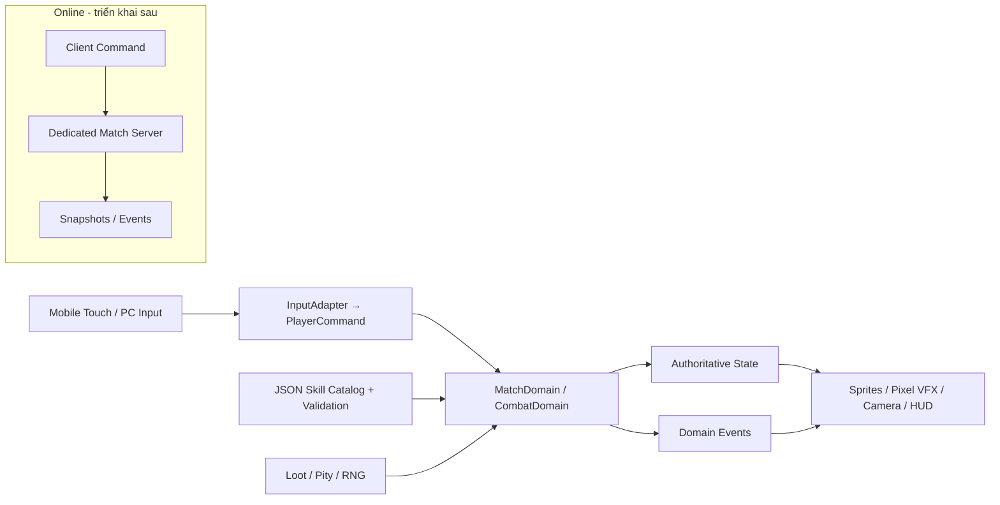

# ARCHITECTURE.md — Kiến trúc Godot cho Shinobi Evolution

**Trạng thái:** `PROPOSED / NOT YET IMPLEMENTED` • **Phiên bản:** 1.0 • **Ngày:** 2026-10-16.

> Tài liệu kiến trúc đích cho game 2D HD Pixel Art PvPvE mobile. **Chưa** có code/scene nào được tạo chỉ bằng việc viết file này. Mỗi module bên dưới là specification để Antigravity triển khai theo roadmap, Codex review.

## 1. Công nghệ đã chọn và những thứ để sau

| Lớp | Quyết định | Ghi chú |
|---|---|---|
| Editor quản lý dự án | VS Code | Explorer/Git/diff, Antigravity code, Codex review |
| Engine | Godot 4 **stable version pinned khi tạo project** | sử dụng bản **Standard/GDScript**; ghi chính xác build trong `project.godot` và tài liệu sau khi khởi tạo |
| Programming | GDScript | script có typed signatures; signals cho event UI |
| Render | Compatibility trước | đo trên thiết bị Android mục tiêu; không mặc định shader tính năng render cao cấp |
| Game view | 2D top-down 3/4 camera MOBA | `Camera2D`, `CharacterBody2D`, `TileMapLayer` tùy phiên bản 4.x |
| Graphics | 2D HD Pixel Art, sprite sheet + light pixel VFX | 32×32 tiles, 48×64/64×64 character candidate, nearest-neighbor world |
| Mobile | Android landscape, touch+safe area | PC keyboard/mouse chỉ để debug |
| Network | Phase đầu **offline**, kiến trúc ý niệm server-authoritative | online ở phase sau; **không** tự kết nối Nakama ngay |
| Versioning | Git / GitHub | commit theo feature sau khi review |
| Data | JSON graph + typed domain models | JSON hiện là draft catalog 162 nodes; validator bắt buộc |
| Backend tương lai | Godot dedicated server + Nakama hoặc giải pháp khác sau spike | không khóa công nghệ backend cho đến khi kiểm tra trên thiết bị/latency |

**Tài liệu chính thức khi cần kiểm API:** https://docs.godotengine.org/en/stable/ ; check theo **phiên bản thực tế đã pin** vì API có thể đổi giữa Godot 4.x.

## 2. Sơ đồ hệ thống



**Nguyên tắc:** Hành vi game đi từ lệnh đầu vào → mô hình trận → kết quả → presentation. Sprite hoặc button **không tự cấp Ryō, XP, loot, skill**. Khi prototype offline, `LocalMatchAuthority` thực thi API giống authority tương lai để giảm chi phí chuyển online; **không** cố viết full networking ngay.

## 3. Cấu trúc folder trong project

```text
shinobi-evolution/
  AGENTS.md
  project.godot                       # được Godot tạo, không tạo giả
  docs/
    GAME_DESIGN.md
    ARCHITECTURE.md
    SKILL_SYSTEM.md
    DEVELOPMENT_ROADMAP.md
  data/
    skills/skills.json                # catalog design-time (162 nodes)
    clans/                            # chỉ tạo khi có schema và task
    items/
  scenes/
    main/main.tscn
    actors/player/player.tscn
    actors/enemy/basic_enemy.tscn
    maps/test_arena.tscn
    maps/tilesets/
    ui/hud.tscn
    ui/virtual_joystick.tscn
    ui/skill_graph.tscn
    combat/projectiles/
    combat/vfx/
  scripts/
    app/
    input/
    domain/
      actors/
      combat/
      skill_graph/
      economy/
      loot/
      match/
    infrastructure/
      data/
      persistence/
      network/                       # chưa dùng trong prototype
    presentation/
      actors/
      hud/
      vfx/
  assets/
    sprites/characters/
    sprites/enemies/
    tilesets/
    vfx/
    ui/
    audio/
  tests/
    unit/
    integration/
    fixtures/
  builds/                             # ignored bởi git
```

**Nguyên tắc đặt tên:** `snake_case` file và script; `PascalCase` lớp `class_name` khi thật sự cần chia sẻ; skill/item/clan ID dạng `UPPER_SNAKE_CASE` ổn định.

**Không tạo tất cả thư mục trống trong task 1.** Scene/script tạo theo yêu cầu; mỗi thư mục phải gắn với module thực tế.

## 4. Hợp đồng scene và ownership

### 4.1 Main + Map (proposal)

```text
Main (Node2D)
  MatchRoot (Node2D)
    World (Node2D)
      Ground (TileMapLayer)
      Obstacles (TileMapLayer)
      Entities (Node2D, y_sort_enabled=true)
      GroundTelegraphs (Node2D)
      GameplayVolumes (Node2D)
    LocalPlayer (instance player.tscn)
  WorldCamera (Camera2D)
  UI (CanvasLayer)
    HUD (Control)
    Controls (Control)
    Toasts (Control)
```

Nếu dùng `YSort` dưới actor/props, `z_index` và sorting origin đặt ở chân sprite, không dựa vào phần đầu/tóc. Các `TileMapLayer` ở Godot 4.x cần xác nhận trong version pinned trước khi code; không tạo scene với node không có trong engine đang dùng.

### 4.2 Player (proposal)

```text
Player (CharacterBody2D)
  CollisionShape2D
  VisualPivot (Node2D)
    AnimatedSprite2D
    CastAnchor (Marker2D)
    StatusMarkers (Node2D)
  HitReceiver (Area2D)        # nhận hit logic; tách body collision
  AnimationPlayer
  Components (Node)
    ActorStats
    SkillLoadout
    StatusContainer
```

`PlayerController` nhận `PlayerCommand`, điều khiển actor domain; `PlayerView` chỉ play animation/chạy VFX. HP và mana/chakra thuộc domain/state, không lưu độc quyền trong HUD.

### 4.3 Camera và Mobile HUD

- `Camera2D`: theo local actor; zoom chỉ thay đổi mức cần thiết, không cho camera cắt mất telegraph của kẻ địch mà vẫn gây hit. Có cấu hình giới hạn map và smooth follow.
- `CanvasLayer` UI anchor theo viewport thực, lấy safe-area nếu có; tách **world logical resolution** khỏi **screen UI readability**.
- Left virtual joystick: pointer/touch ID cố định khi giữ; deadzone, clamp radius, convert về vector normalized.
- Right buttons: basic attack, 4 skills, 1 ultimate, Thế thân, nhẫn cụ; hỗ trợ drag-to-aim, visual cool-down và trạng thái `out_of_chakra`.
- Input PC debug: WASD, chuột aim, hotkey 1–5/Space. **Không** làm gameplay phụ thuộc con trỏ chuột.

## 5. Chia module và API khuyến nghị

| Module | Trách nhiệm | Không được làm |
|---|---|---|
| `InputAdapter` | ánh xạ touch/keyboard → `PlayerCommand` | tự gây damage hoặc mua skill |
| `ActorMovement` | velocity, dash, collision, move restrictions | ghi trực tiếp UI |
| `ActorStats` | HP, chakra, levels, resistances, events | tự spawn loot |
| `CombatResolver` | target checks, hit/damage/heal/CC và log combat | quyết định bằng frame animation/VFX |
| `SkillCatalog` | load/validate/lookup design catalog | cho phép mua node locked |
| `SkillUnlockService` | check level/SP/Ryō/AND/OR/gates/exclusions | bỏ qua gate tiếng Việt |
| `SkillLoadout` | equipped active/ultimate/passive/substitution | trang bị node chưa có runtime implementation |
| `SkillExecutor` | gọi ability behavior đã đăng ký | giant switch 162 ID |
| `LootService` | drop table, pity, loot rights và seed | RNG client khi online |
| `EconomyService` | XP/Ryō/SP reward và spend atomic | âm tiền, double spend |
| `MatchStateMachine` | phase, objectives, revive, victory | đọc FPS để suy luận state |
| `WorldReactionService` | tags môi trường + tương tác có giới hạn | tạo tự động huyết kế |
| `VFXPresenter` | telegraph, particles, animation/audio | xác thực hit hoặc range |
| `DataValidator` | schema, references, graph DAG, gate readiness | âm thầm bỏ qua node lỗi |

**Thông điệp domain định dạng typed**, ví dụ:

```gdscript
# Khung API để triển khai sau, không phải file đã được tạo.
class_name PlayerCommand
extends RefCounted

var move_axis: Vector2 = Vector2.ZERO
var aim_axis: Vector2 = Vector2.ZERO
var cast_slot: int = -1  # -1 = không cast
var is_dashing: bool = false
```

Game prototype có thể dùng signals `hp_changed`, `skill_unlocked`, `currency_changed` cho UI; khi online, các event được phát từ trạng thái server xác nhận, không phải client tự thay data.

## 6. Runtime model các kỹ năng

**Hai lớp dữ liệu khác nhau:**

1. `data/skills/skills.json` là **catalog thiết kế và đồ thị**. Một node có thể là root/passive/tier gate; chưa bắt buộc có damage/cooldown.
2. `SkillRuntimeDefinition` (tạo ở milestone skill execution) là **hợp đồng combat hoạt động**, chỉ áp dụng cho node được triển khai thật và được duyệt. Mỗi entry trỏ bằng `id` vào catalog.

Không giả định mọi node JSON đều là một skill có thể cast. Danh mục hiện có 162 node; bản prototype chỉ hiện thực hóa một tập nhỏ. **Mọi node có `implementation_status=design_only` không thể trang bị hoặc cast** cho đến khi có runtime def hợp lệ.

### 6.1 Loader, schema và validation

Đọc `SKILL_SYSTEM.md` mục Schema để biết các field chi tiết. Quy trình load:

```text
Read JSON → check schema_version / metadata
  → validate node IDs unique, tier 0..5, rank, required types
  → validate prereq references and requires_any groups
  → detect cycles (topological sort)
  → validate synergy type and inputs (skill_id or element_token)
  → validate optional runtime bindings / entrypoints
  → report errors (fail-fast in test/debug)
```

Catalog không được gọi "production ready" chỉ vì JSON parse được. Với `unlock_gate` dạng chuỗi còn lại, **gate trạng thái chưa cấu hình phải `LOCKED`**, UI hiện "Chưa hoàn tất điều kiện mở nhánh" kèm nhãn thiết kế khi ở debug; không tự cho qua.

### 6.2 Mô hình check unlock

```
can_unlock(actor, skill_id, match_state):
  require(skill_id exists && implementation approved for progression)
  require(actor.level >= tier.min_level)
  require(all prereqs in requires_all are learned)
  require(for each OR group in requires_any, at least one is learned)
  require(gate policy explicitly resolved and evaluates true)
  require(not blocked by exclusive group / clan / bloodline)
  require(actor.SP >= skill cost.SP && actor.Ryō >= cost.Ryō)
  require(if needed, server-auth inventory item/pact/quest flag)
  then atomic transaction: spend → learn → consume item → emit event
```

**Lưu ý:** node `T0` khởi đầu được cấp theo policy, không cần người chơi thao tác mua. Sự phát triển Hiden/huyết kế chỉ thông qua policy đã duyệt; `unlock_gate` hiện là chú thích **chưa chạy máy**.

### 6.3 Hành vi kỹ năng mở rộng

Thay vì 162 class không chia sẻ logic, triển khai ability archetypes:

- `ProjectileAbility`: Hỏa Cầu, Thủy Đạn, Shuriken.
- `DashAbility`: áp sát/lướt/Thiên Điểu biến thể.
- `AreaAbility`: Hỏa Vực, Thổ Trận, sương, bẫy.
- `MeleeHitAbility`: Nhu Quyền, combo thể thuật.
- `BuffAbility`: Sharingan state, Bát Môn, chakra armour.
- `ControlAbility`: trói bóng, stun, câm kỹ năng, Genjutsu.
- `SummonAbility`: Ảnh Phân Thân, côn trùng, nhẫn khuyển, khôi lỗi.
- `BarrierAbility`: kết giới, tường đất, ma kính.

Các giá trị cụ thể do runtime def có schema/validator riêng, **không hardcode** theo tên Việt. `skill_id` để tra dữ liệu, `archetype` để gọi behavior, `tags` để tương tác.

### 6.4 Trạng thái và hiệu ứng kết hợp

Status tags đề xuất: `WET`, `BURNING`, `ELECTRIFIED`, `SHADOW_BOUND`, `CHAKRA_SEALED`, `STEALTH`, `MARKED`, `INVULNERABLE_WINDOW` (có TTL + stacking rule). Tags dùng trong va chạm, không phải phép tạo huyết kế.

Phản ứng nước + điện: area có `WET` → điện tương tác → lan theo danh sách target được xác nhận, giới hạn số chain và độ sâu, **server tính hit, client vẽ tia**. Hỏa + Phong: thay đổi bán kính/tốc độ vùng lửa **chỉ khi có rule**, không tự nhân damage không giới hạn.

## 7. Combat và phép tính authoritative

### 7.1 Pipeline đề xuất

```text
PlayerCommand: cast(slot, direction, optional target)
 → validate alive/not CC, loadout + cooldown + chakra
 → consume costs, start cast on authority
 → telegraph/cast event (camera không quyết định hit)
 → resolve range/collision/LOS/team filter
 → CombatResolver: mitigation, shield, damage, CC diminishing returns
 → apply state and emit result event
 → renderer animate result
```

Bảng giá trị damage thật chưa chốt. Ưu tiên **fixed-step** logic, state transitions rõ; không dùng `delta` phân tán theo FPS để đổi kết quả combat. `Area2D` hỗ trợ broad-phase nhưng không dùng signal client cục bộ làm bằng chứng authority cho kill.

### 7.2 Anti-CC chain

Diminishing returns theo nhóm effect và khoảng thời gian, trạng thái Thế thân cơ bản có thể thoát 1 lần nếu đúng cửa sổ. Quy tắc chống chain-lock cần test và cấu hình, không để target mất quyền thao tác > một ngưỡng không kiểm soát.

## 8. PvE / loot / economy transactions

- NPC spawn manager theo zone có giới hạn entity, không spawn hàng trăm AI ngoài màn hình.
- Loot table được version hóa, seed log trong dev. Pity state theo `(match_id, player_id, loot_group_id)`, không trộn counters giữa các nhóm.
- Mỗi phần thưởng có unique event/reward id và `consumed` flag hoặc idempotent transaction để chống nhận trùng khi reconnect.
- Mua skill và consume cuộn phải cùng một transaction logic. Bất kỳ lỗi giữa chừng phải rollback trạng thái hợp lệ.
- Server quyết định drop, loot ownership, pickup range, cooldown pickup, vàng thu nhập và điều kiện mở nhánh.
- **Solo offline** `LocalMatchAuthority` đảm nhiệm cùng logic; không để client trực tiếp sửa via HUD.

## 9. Multiplayer — triển khai theo cổng kiểm chứng

**Chưa làm ở milestone offline.** Mục tiêu online server authoritative, tránh chuyển game từ peer-to-peer tin client khi đã có kinh tế và PvP phức tạp.

### 9.1 Kiến trúc dài hạn

```text
Android Client (Godot)
  input prediction + VFX + UI
        |
      commands
        v
Match Server (dedicated/headless Godot hoặc authoritative service)
  validates input / state / damage / loot / unlocking / win
        |
      snapshots + events
        v
Android Client (reconciliation/interpolation)

Matchmaking / account / lobby (Nakama hoặc tương đương, quyết định sau spike)
```

**Phân công:** backend matchmaking có thể cấp phòng/đăng nhập, nhưng **không đương nhiên** là nơi tính hit. Trước khi triển khai, thực hiện spike đo độ trễ và kiến trúc giữa Godot server và Nakama. Không lập toàn bộ stack ngay bây giờ.

### 9.2 Hợp đồng tối thiểu

- Input command có `player_id` do session gán, sequence, timestamp kiểm tra giới hạn; dùng stream không tin client.
- Server chạy tick đều (mốc thử nghiệm 20–30Hz, chọn sau profiling) và gửi snapshot/interpolation; projectile hit được server xác nhận.
- Client có dự đoán chuyển động bản thân **nếu cần** nhưng không tự công nhận kill/loot/skill.
- Chống spam RPC, speedhack, teleport, spam cast, client time manipulation và payload `skill_id` lạ.
- Tái kết nối: session, snapshot, xử lý vật phẩm còn/đã consume, Grace period và trạng thái AFK.
- Data event theo match id + version/schema; không tiết lộ seed RNG thật nếu còn ảnh hưởng drop.

### 9.3 Bài test phản gian lận mẫu

1. Client gọi unlock T5 ở level 1 → server từ chối.
2. Client tự sửa HP=99999 → snapshot authoritative ghi đè.
3. Client báo trúng mục tiêu cách xa range → từ chối.
4. Client gửi cùng loot claim 2 lần → chỉ 1 transaction.
5. Client chưa có huyết kế mà gửi `YUKI_ICE` → từ chối.
6. Disconnect ngay lúc giết boss/claim loot → không được thưởng trùng.

## 10. Android + Pixel performance budgets

**Benchmark phải đo, không tuyên bố đạt sẵn.** Tùy thiết bị; ban đầu đặt mục tiêu 30 FPS ổn định ở cấu hình thử thấp và 60 FPS ở cấu hình khuyến nghị, rồi chỉnh sau khảo sát thiết bị.

- Map chunk/cell được load/AI simulate theo khoảng cách và mức ảnh hưởng trận, nhưng mục tiêu tranh chấp do authority vẫn cập nhật đúng.
- Sprite atlas, hạn chế material switch/texture fragmentation và overdraw; dùng `MultiMeshInstance2D`/particles phù hợp **chỉ khi profiling cho thấy cần**.
- VFX quality 3 cấp, giới hạn số emitter đang hoạt động, pooled projectile/impact decals; không spawn hàng nghìn côn trùng actor.
- Clone/summon tối đa theo kit; `entity_budget` toàn vùng và per-player cấu hình được. AI đơn giản tick thấp hơn camera nếu đủ xa; combat authority không bỏ tính toán cần thiết.
- Mob AI/đạn/vùng hiệu ứng không cập nhật bằng hàng trăm `_process()` thừa nếu có thể dùng manager/batching.
- Texture nearest-neighbor cho sprite; HUD font & touch icons có kích thước thực dễ đọc trên màn hình nhỏ. Viewport world thử `640×360`, scale test 16:9–20:9; kiểm safe area notch.
- Điện thoại nóng, RAM và battery drain là tiêu chí chất lượng; đo frame-time p95, draw calls, memory peak, network bytes/s; log theo thiết bị.

### 10.1 Chất lượng VFX khi teamfight

- Priorities: **enemy telegraph nguy hiểm > hit confirmation > self skill > ally cosmetic effect**.
- Có tùy chọn giảm flash/camera shake. Viền telegraph rõ trên nền rừng và mặt nước, không truyền thông tin chỉ bằng màu (thêm shape/icon/pattern).
- Animation cast có anticipation đủ để nhận biết; damage zone không bị thay bởi particle ngẫu nhiên.

## 11. Save / Settings / Content version

- Ngoài trận lưu: settings, preset build, keybindings/mobile layout, cosmetic, tutorial progress. Không lưu permanent combat stats mang vào ranked.
- Trong trận (online) lưu state trên authority: XP, currency, SP, learned node IDs, equipped IDs, items, pity, objective events. Client cache chỉ để hiển thị.
- Save/content data có `schema_version`, checksum hoặc build hash. Khi JSON thay đổi, chạy migration có kiểm tra; ID node không đổi nếu đã được save dùng.
- Release build không có debug unlock command hoặc developer cheat UI.
- Secrets/signing keystore không commit vào Git.

## 12. Kiểm thử và CI đề xuất

| Loại kiểm thử | Khi chạy | Tiêu chí |
|---|---|---|
| Data validator | mọi sửa `skills.json` | JSON parse, 162 IDs nếu chưa đổi, no dangling ref, no cycle, enums hợp lệ |
| Unit tests | khi thêm domain service | unlock AND/OR, đủ/thiếu Ryō, Pity, DR CC, HP không âm |
| Integration smoke | mỗi scene/feature | Godot import và chạy được main scene |
| Input touch QA | thêm HUD/mobile | không mất pointer ID khi 2 ngón, joystick reset khi nhấc tay |
| Perf stress | sau combat waves | quái + particle + skill bùng nổ vẫn đạt target đo được |
| Online authority tests | trước alpha PvP | client giả mạo hit/loot/unlock bị từ chối |
| Regression Codex | mỗi diff | findings có file và repro, không sửa code |

**Ví dụ CLI khi đã có Godot executable:** `godot --headless --path . --editor --quit` để import/parse; `godot --headless --path . --quit-after 60` để smoke main (sau khi project có main scene). Chạy theo binary/version thực tế; không để AI tự báo PASS khi chưa mở project.

## 13. ADR — quyết định kiến trúc

| ADR | Trạng thái | Quyết định / lý do |
|---|---|---|
| A-001 | CHỐT | Godot 4 Standard + GDScript; dễ vibe code và tự chủ 2D |
| A-002 | CHỐT | VS Code làm trung tâm; Antigravity dev, Codex review |
| A-003 | CHỐT | Top-down 3/4 HD Pixel Art, mobile-first |
| A-004 | CHỐT | Data-driven skill graph, typed runtime behaviors, node ID không đổi |
| A-005 | CHỐT | Offline-first vertical slice; phải tách domain/input/presentation |
| A-006 | PROPOSED | Dedicated authoritative server cho PvP; chọn backend sau network spike |
| A-007 | PROPOSED | Renderer Compatibility, `640×360` world reference, cần device playtest |
| A-008 | PROPOSED | 20–30Hz server simulation, chưa benchmark |

## 14. Điều kiện trước khi bắt đầu task đầu tiên

- Người dùng tạo project bằng Godot (không tạo `project.godot` giả thủ công), bật Git và lưu checkpoint.
- Antigravity kiểm **binary Godot phiên bản cụ thể** và setup local.
- Task 1 chỉ là player di chuyển/camera/collision/placeholder, chưa tạo Nakama, database, 162 ability script hay online logic.
- Review Codex phải tách lỗi thực tế và ý kiến kiến trúc để người mới không bị refactor vô hạn.

### Change Log

| Ngày | Phiên bản | Thay đổi |
|---|---|---|
| 2026-10-16 | 1.0 | Kiến trúc mobile Pixel Art, graph data-driven, workflow Antigravity/Codex và server-authority future plan |
